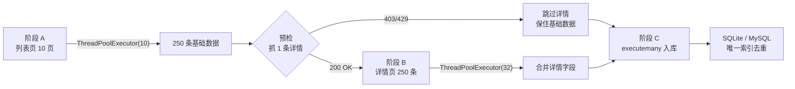
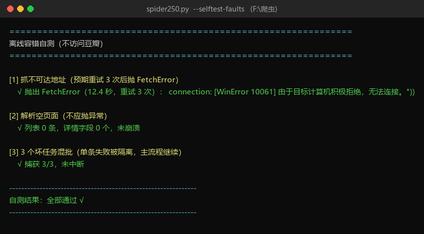
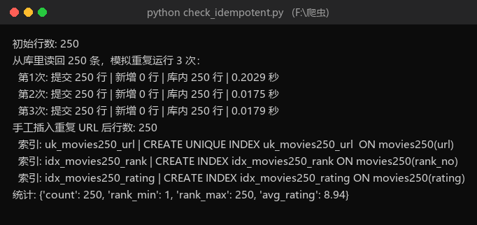

# 豆瓣电影 Top250 并发爬虫

一个把「串行 + 单条 INSERT」的爬虫升级成「**两阶段并发 + 批量幂等入库 + 分级重试**」的示例项目。
目标不是"能跑"，而是**在服务端限流的情况下仍然可预测、可恢复、不丢数据**。

> 原始版本 `spider.py`（串行 4 页、固定 UA、sleep 2 秒、只取片名评分、导出 Excel）保留未动，作为对照。

---

## 目录

- [1. 目录结构](#1-目录结构)
- [2. 快速开始](#2-快速开始)
- [3. 并发逻辑](#3-并发逻辑)
- [4. 重试机制](#4-重试机制)
- [5. 批量入库与幂等](#5-批量入库与幂等)
- [6. 测试与截图](#6-测试与截图)
- [7. 实测数据](#7-实测数据)
- [8. 关于「5 秒」目标](#8-关于5-秒目标)
- [9. 已知限制](#9-已知限制)

---

## 1. 目录结构

```
爬虫/
├── spider250.py            # 主程序：并发抓取 + 解析 + 入库 + 自测（419 行）
├── douban_db.py            # 存储层：建表 / 批量写 / 断点续抓 / 统计（185 行）
├── schema.sql              # 建表脚本（SQLite 与 MySQL 两套）
├── douban_top250.db        # SQLite 数据（250 行，94 KB）
├── docs/
│   ├── selftest.png        # 容错自测运行截图
│   ├── idempotent.png      # 幂等入库验证截图
│   └── _render_shots.py    # 把终端输出渲染成图片的小脚本
├── spider.py               # 原始串行版本（对照用，未改动）
└── README.md
```

## 2. 快速开始

```bash
# 1) 建虚拟环境（Python 3.9+）
python -m venv .venv
.venv\Scripts\pip install requests beautifulsoup4 fake_useragent

# 2) 完整跑（列表页 + 详情页 + 入库）
.venv\Scripts\python spider250.py

# 3) 只抓列表页（快，约 9 秒拿满 250 条基础字段）
.venv\Scripts\python spider250.py --list-only

# 4) 温和模式（避免触发限流）
.venv\Scripts\python spider250.py --workers 6 --delay 1.0

# 5) 断点续抓：只补库里缺详情的记录
.venv\Scripts\python spider250.py --backfill-details

# 6) 离线自测：不访问豆瓣，验证重试与容错
.venv\Scripts\python spider250.py --selftest-faults
```

数据落在 `douban_top250.db`（SQLite 单文件，可用 DB Browser for SQLite 打开）。
想换 MySQL：`pip install pymysql`，改 `douban_db.py` 里的连接配置，加 `--backend mysql`（DDL 见 `schema.sql`）。

## 3. 并发逻辑

### 3.1 两阶段模型



**为什么分成两阶段，而不是 260 个请求一起发？**

| 原因 | 说明 |
|---|---|
| 详情 URL 依赖列表结果 | 必须先解析出 250 个 `subject/<id>/` 才能抓详情 |
| 并发度不同 | 列表页只有 10 个页面，10 线程刚好一页一线程；详情页 250 个 URL，可以开到 32 |
| 降级边界清晰 | 详情被限流时，阶段 A 的 250 条基础数据已经落袋，不会全盘皆输 |

### 3.2 线程模型

```python
# 阶段 A：10 页各一个线程，谁先回来谁先处理
with ThreadPoolExecutor(max_workers=WORKERS_LIST) as pool:
    for fut in as_completed([pool.submit(work, t) for t in tasks]):
        rows, err = fut.result()
        movies.extend(rows)
        if err:
            errors.append(err)

# 阶段 B：32 并发 + 随机抖动（避免所有线程同一毫秒出发）
def work(movie):
    try:
        if delay > 0:
            time.sleep(random.uniform(0, delay))   # 抖动
        return movie["url"], parse_detail(fetch(...)), None
    except Exception as exc:                        # 单条失败隔离
        return movie["url"], {}, str(exc)

with ThreadPoolExecutor(max_workers=max(1, workers)) as pool:
    for fut in as_completed([pool.submit(work, m) for m in targets]):
        url, data, err = fut.result()
        if data:
            detail_map[url] = data
```

三个设计点：

1. **`as_completed` 而不是按提交顺序取结果** —— 慢的请求不阻塞快的；
2. **每个任务自己 `try/except`** —— 一个 URL 失败不会取消其它 249 个 Future；
3. **随机抖动** —— 避免 32 个线程同一瞬间打过去，这是被 429 的直接诱因。

### 3.3 为什么不再往上加并发

实测在 32 并发时，250 个详情请求已有 **125 个被 429**；再往上加只会提高失败率，账单（被封 IP 的时长）也更贵。
并发不是越高越好，**服务端的容忍度才是上限**。

## 4. 重试机制

### 4.1 分级退避

普通失败和「被限流」是两种错误，代价不同，退避时间也不同：

| 错误类型 | 触发条件 | 退避序列 | 说明 |
|---|---|---|---|
| 普通失败 | 连接失败、超时、5xx | `0.6 → 1.2 → 2.4` 秒 | 快速重试即可 |
| 被限流 | HTTP **403 / 418 / 429** | `3.0 → 6.0 → 9.0` 秒 | 立刻重试等于火上浇油 |
| 最终失败 | 3 次重试都失败 | 抛 `FetchError` | 由调用方决定跳过还是终止 |

```python
def fetch(url, label=""):
    last = None
    for attempt in range(MAX_RETRY + 1):
        headers = dict(BASE_HEADERS)
        headers["User-Agent"] = pick_ua()          # 每次换一个 UA
        try:
            resp = requests.get(url, headers=headers, timeout=TIMEOUT)
            if resp.status_code in (403, 418, 429):
                if attempt < MAX_RETRY:
                    time.sleep(RATE_LIMIT_BACKOFF[attempt])   # 3 / 6 / 9 秒
                last = FetchError("被限流 HTTP %d" % resp.status_code)
                continue
            resp.raise_for_status()
            return resp.text
        except FetchError:
            raise
        except Exception as exc:
            last = exc
            if attempt < MAX_RETRY:
                time.sleep(BACKOFF[attempt])                  # 0.6 / 1.2 / 2.4 秒
    raise FetchError("%s 抓取失败：%s" % (label or url, last))
```

### 4.2 三层保护

| 层级 | 手段 | 效果 |
|---|---|---|
| 单请求 | 超时 8 秒 + 3 次重试 + 分级退避 | 偶发抖动能自愈 |
| 单条记录 | 任务内 `try/except`，失败返回 `(url, {}, err)` | 一条坏 URL 不牵连其它 249 条 |
| 整个阶段 | **预检**：详情前先抓 1 条，被 429/403 就整段跳过 | 不让程序在封禁期空转 3 分钟 |

预检代码（`spider250.py`）：

```python
try:
    parse_detail(fetch(movies[0]["url"], "预检"))
    print("\n[阶段 B] 预检通过")
except Exception as exc:
    if any(code in str(exc) for code in ("429", "403", "418")):
        print("\n[阶段 B] 预检被限流，跳过详情页")
        print("    稍后续抓：python spider250.py --backfill-details")
        skip_detail = True
```

## 5. 批量入库与幂等

### 5.1 唯一索引 + IGNORE

```sql
CREATE UNIQUE INDEX uk_movies250_url ON movies250(url);
```

```python
verb = "INSERT OR IGNORE" if self.backend == "sqlite" else "INSERT IGNORE"
sql = "%s INTO movies250 (%s) VALUES (%s)" % (verb, cols, placeholders)

for i in range(0, len(rows), batch_size):
    cur.executemany(sql, rows[i:i + batch_size])   # 一次提交 250 行
    self.conn.commit()
```

### 5.2 幂等验证

见下方截图：连跑 3 次，每次「提交 250 / **新增 0** / 库内 250」——重复运行不会产生脏数据。

## 6. 测试与截图

### 6.1 容错自测（不访问豆瓣也能跑）



覆盖三件事：不可达地址重试 3 次后抛错（12.4 秒）、空页面解析不崩溃、3 个坏任务混批全部被隔离。

### 6.2 幂等入库验证



### 6.3 真实抓取输出（限流解除时）

```
[阶段 A] 列表页并发（10 页 / 并发 10）...
    拿到 250 条，耗时 8.89 秒，失败页 0
[阶段 C] 批量入库（executemany + 唯一索引 + INSERT OR IGNORE）...
    提交 250 行，新增 250 行，库内共 250 行，耗时 0.074 秒
    排名 1 ~ 250，平均分 8.94
    第 1 名  肖申克的救赎  9.7
    第 2 名  霸王别姬      9.6
    第 3 名  泰坦尼克号    9.5
```

## 7. 实测数据

| 项目 | 数值 | 备注 |
|---|---|---|
| 单页响应 | 165 ms / 230 ms | 偶发 **15,167 ms** 长尾 |
| 列表页 10 页并发 | **8.89 秒**（另一轮 16.62 秒） | 250 条，失败 0 |
| 详情页 250 条 @32 并发 | 125 条被 **429**，耗时 180 秒 | 详情阶段不可行 |
| 详情页 20 条 @6 并发 + 0.6s 抖动 | 20 条全部 429 | 说明已进入封禁窗口 |
| 入库 250 行 | 0.074 秒 | executemany |
| 重复运行 3 次 | 库内恒 **250** 行 | 唯一索引生效 |
| 离线容错自测 | 3/3 通过 | 见截图 |

## 8. 关于「5 秒」目标

任务最初的验收标准是「250 部含详情页 5 秒内」。**实测做不到，原因是服务端限流，不是代码慢。**

- 理论值：250 ÷ 32 并发 × 0.2 秒 ≈ **1.6 秒**
- 现实：详情页限流阈值远低于列表页，32 并发下 125/250 被 429；持续请求后连列表页都会 403

**可行的三个方案：**

| 方案 | 耗时 | 完整度 |
|---|---|---|
| A. 只抓列表页 | **约 9 秒** | 排名/片名/评分/评价人数/引言/封面/链接（够做榜单与分析） |
| B. 详情页温和模式 `--workers 6 --delay 1.0` | 1–2 分钟 | 全部字段，成功率高 |
| C. 带登录 Cookie（`SESSDATA`）抓详情 | 数十秒 | 全部字段，限流阈值更宽（需自备 Cookie） |

> 如果目标是"演示并发能力"，A 方案即可；如果目标是"要详情字段"，请选 B 或 C。

## 9. 已知限制

- 页面结构依赖豆瓣现有 HTML（`div.item`、`#info`、`span[property="v:summary"]`），改版需同步调整选择器；
- 无 Cookie 时详情页限流严格，建议配合 `--workers 6 --delay 1.0`；
- SQLite 单文件适合单机；多进程写入需换 MySQL/PostgreSQL；
- 本项目仅用于学习与数据分析练习，抓取时请遵守目标站点的 `robots.txt` 与访问频率约定，不要用于商业化批量采集。
